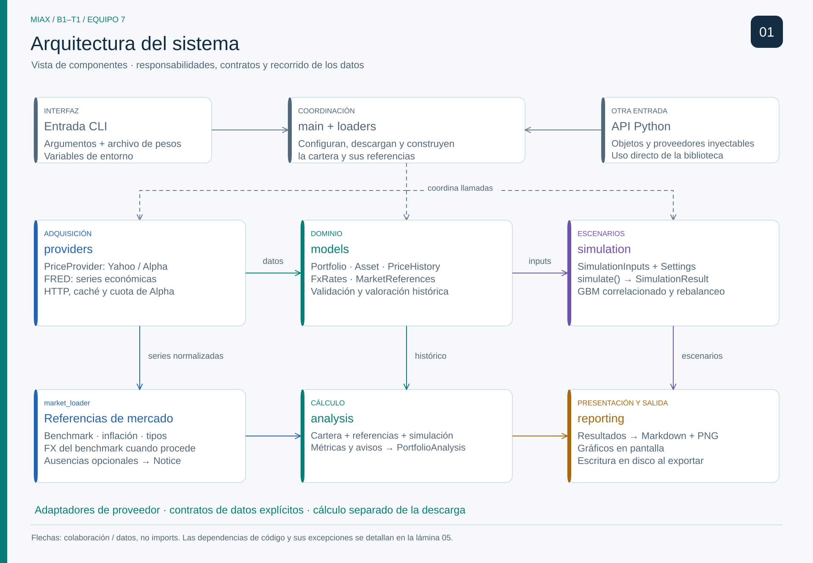
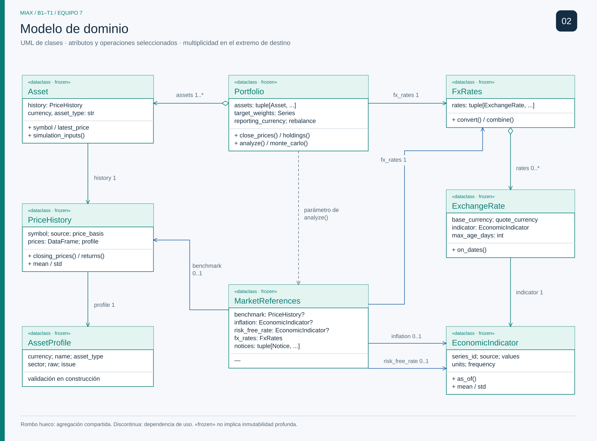
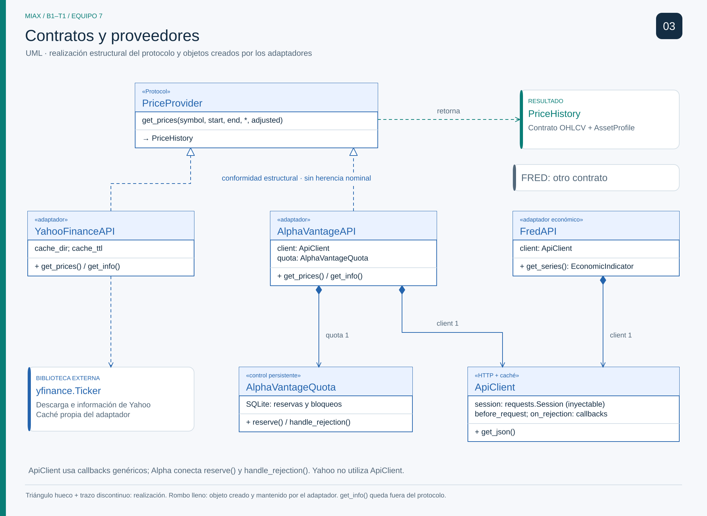
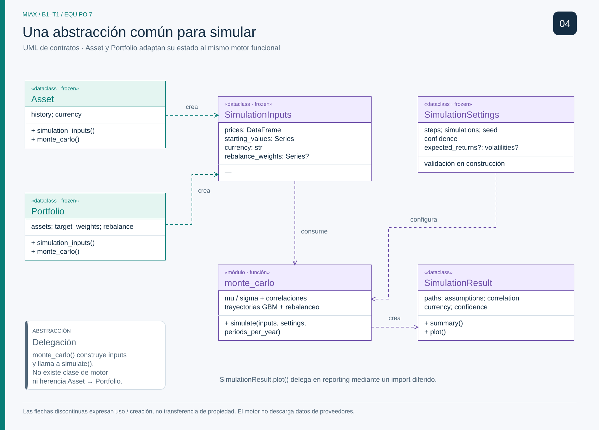
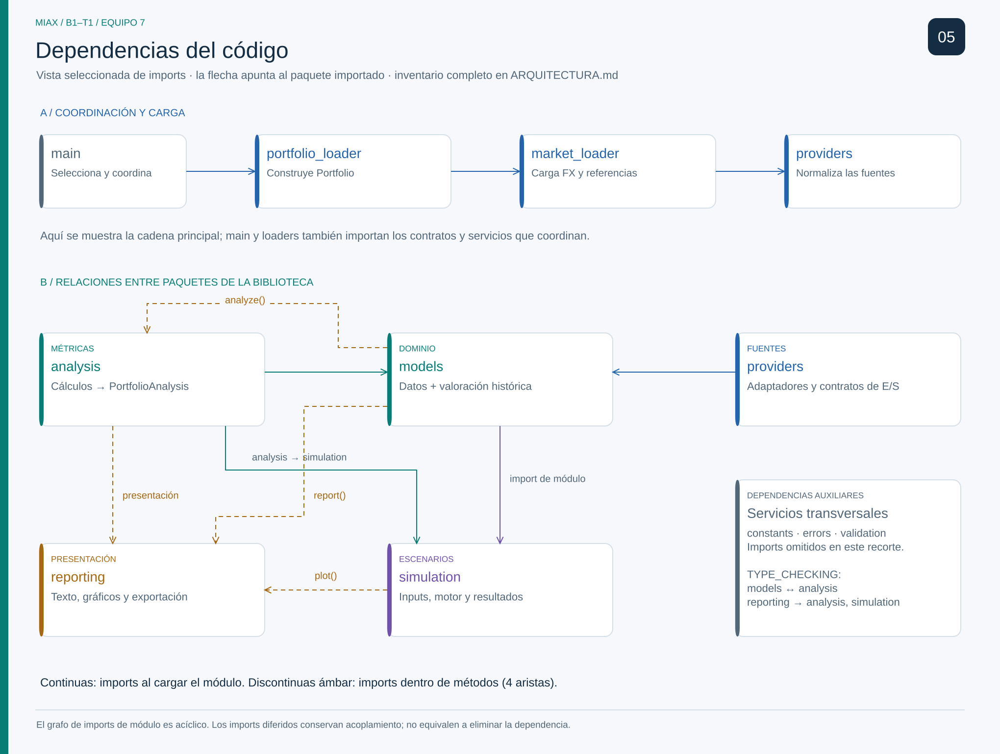
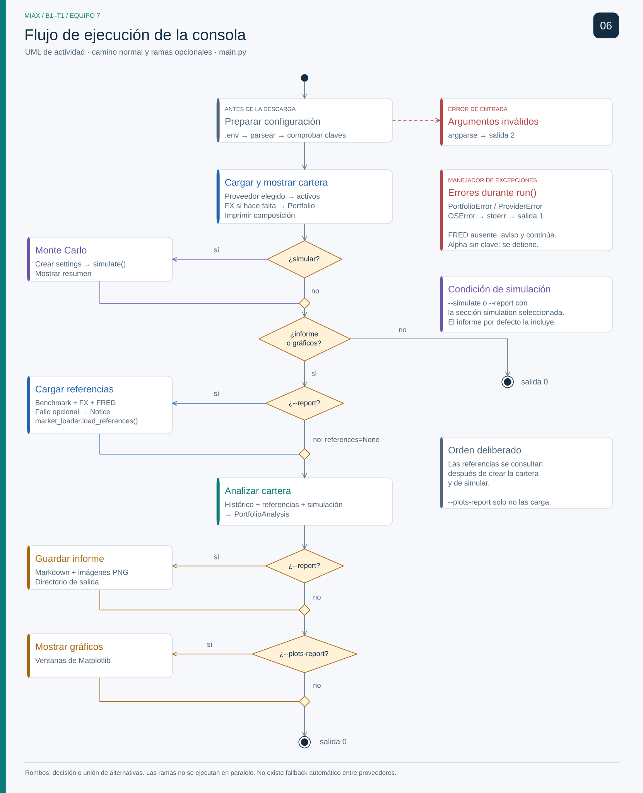
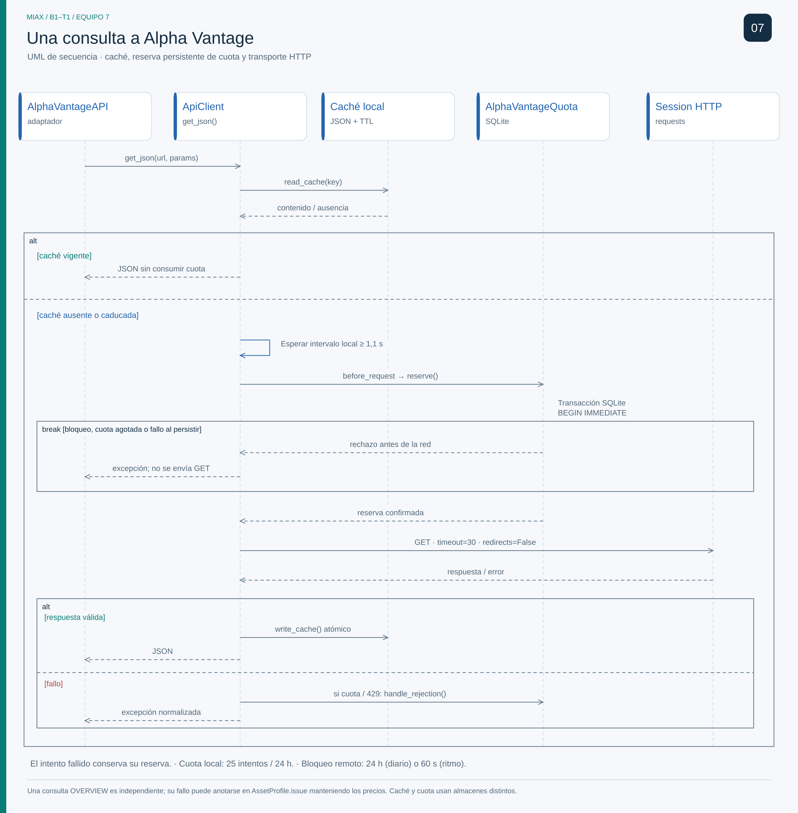

# Arquitectura · B1–T1 / Equipo 7

Siete vistas complementarias explican la estructura del toolkit, sus contratos y su ejecución. Los nombres de clases y métodos coinciden con el código; las imágenes se pueden ampliar sin perder calidad y editar en Excalidraw.

**Referencia:** árbol de trabajo local del 31 de octubre de 2026, con cambios sobre `main` **`141bc12`**. No representa exclusivamente el commit. [El manifiesto](diagramas/verificacion.json) identifica las fuentes y los artefactos mediante hashes; al cambiar el código, hay que revisar qué láminas quedan afectadas.

| Lámina | Vista formal | Pregunta que responde |
| --- | --- | --- |
| [01 · Arquitectura](#01--arquitectura-del-sistema) | Componentes y responsabilidades | ¿Qué hace cada parte y dónde ocurre la E/S? |
| [02 · Modelos de dominio](#02--modelos-de-dominio) | Clases UML | ¿Qué objetos forman una cartera y qué referencias comparten? |
| [03 · Proveedores](#03--contratos-y-proveedores) | Clases e interfaces UML | ¿Cómo se intercambia la fuente y se controla el acceso externo? |
| [04 · Simulación](#04--contrato-de-simulación) | Contratos y dependencias UML | ¿Cómo comparten motor un activo y una cartera? |
| [05 · Dependencias](#05--dependencias-entre-paquetes) | Dependencias de paquetes | ¿Qué módulos dependen de cuáles y cuándo se importan? |
| [06 · Flujo CLI](#06--flujo-de-la-aplicación) | Actividad UML | ¿Qué pasos y decisiones sigue una ejecución? |
| [07 · Consulta Alpha](#07--secuencia-de-una-consulta-alpha-vantage) | Secuencia UML | ¿Cómo interactúan caché, cuota, HTTP y errores? |

## Cómo leer las láminas

| Notación | Significado |
| --- | --- |
| Línea continua y triángulo hueco | Generalización: herencia nominal de clase. |
| Línea discontinua y triángulo hueco | Realización del contrato; en `PriceProvider`, conformidad estructural con un `Protocol`. |
| Rombo hueco | Agregación compartida: la parte puede existir y reutilizarse fuera del conjunto. |
| Rombo relleno | Composición de colaboradores creados por el adaptador; expresa el diseño de propiedad, no una restricción del recolector de Python. |
| Asociación con multiplicidad | Referencia conservada por un objeto; `1`, `0..1`, `1..*` y `0..*` indican cardinalidades. |
| Dependencia discontinua | Uso de un tipo, función o paquete; no implica guardar una referencia. |
| `«module»` / `«function»` | Funciones reales del código; no son clases añadidas para el diagrama. |
| `frozen=True` | Impide reasignar atributos; no garantiza inmutabilidad profunda ni validación automática del contenido. |

Las flechas se interpretan según la vista: **responsabilidad/interacción** en 01, **importación** en 05 y **orden de ejecución** en 06–07. Las multiplicidades describen referencias, no cantidades de peticiones ni escenarios.

## 01 · Arquitectura del sistema

[PNG](diagramas/01-arquitectura.png) · [Editar en Excalidraw](diagramas/01-arquitectura.excalidraw) · [Fuente Mermaid](diagramas/01-arquitectura.mmd)

Esta vista organiza **responsabilidades y llamadas del sistema**, no todas las importaciones. `main` compone la ejecución; los cargadores obtienen y transforman datos; los adaptadores encapsulan los servicios externos. Los modelos y los cálculos trabajan con contratos normalizados. `reporting` presenta resultados y escribe Markdown e imágenes, por lo que sí realiza E/S local.

El límite `PriceProvider` aplica inversión de dependencias en la carga de precios. La selección concreta sigue siendo responsabilidad de la composición de la aplicación: la CLI y los cargadores también conocen adaptadores. Esta separación se inspira en puertos y adaptadores; no presupone una arquitectura hexagonal estricta en todo el repositorio.

**Fuentes:** [main.py](src/main.py), [portfolio_loader.py](src/portfolio_loader.py), [market_loader.py](src/market_loader.py), [providers](src/providers), [reporting/export.py](src/reporting/export.py).

## 02 · Modelos de dominio

[PNG](diagramas/02-modelos-dominio.png) · [Editar en Excalidraw](diagramas/02-modelos-dominio.excalidraw) · [Fuente Mermaid](diagramas/02-modelos-dominio.mmd)

`PriceHistory` conserva precios y procedencia; `AssetProfile`, los metadatos; `Asset`, la identidad y divisa del activo. `Portfolio` reúne activos y asigna pesos, capital y política de rebalanceo. Un activo puede participar en varias carteras: su peso pertenece a cada cartera, no al propio activo. Por eso las relaciones del dominio usan asociación o agregación compartida.

`FxRates` agrupa pares directos o inversos y `ExchangeRate` añade significado de divisa a un `EconomicIndicator`. `MarketReferences` contiene referencias opcionales de benchmark, inflación y tipo libre de riesgo, además de cambios de divisa para el benchmark. `FxRates.combine()` permite reunirlos con los de la cartera para la comparación.

La versión local incorpora copias defensivas en `PriceHistory`, estadísticas de niveles de precio calculadas al construirlo y protección del almacenamiento numérico de pesos e indicadores. Esto no convierte todos los contenedores y resultados del sistema en profundamente inmutables. La alineación de activos conserva fechas comunes sin rellenar huecos; no implementa un calendario bursátil explícito.

**Fuentes:** [models/portfolio.py](src/models/portfolio.py), [asset.py](src/models/asset.py), [price_history.py](src/models/price_history.py), [currency.py](src/models/currency.py), [references.py](src/models/references.py), [snapshot.py](src/models/snapshot.py).

## 03 · Contratos y proveedores

[PNG](diagramas/03-proveedores.png) · [Editar en Excalidraw](diagramas/03-proveedores.excalidraw) · [Fuente Mermaid](diagramas/03-proveedores.mmd)

Yahoo y Alpha satisfacen estructuralmente `PriceProvider.get_prices()`: no heredan nominalmente del protocolo y `get_info()` no forma parte de ese contrato. FRED devuelve `EconomicIndicator`, por lo que se representa fuera de esa realización. Los adaptadores traducen formatos externos al dominio común: ese es el patrón **Adapter** que justifica intercambiarlos.

Alpha y FRED crean su propio `ApiClient`; Yahoo utiliza `yfinance` y comparte utilidades de caché, pero no ese cliente HTTP. Alpha crea además `AlphaVantageQuota` e inyecta sus métodos como callbacks genéricos del cliente. `requests.Session` puede suministrarse desde fuera, así que su relación es asociación, no composición exclusiva. La cuota persistente y la caché tienen cometidos distintos.

**Fuentes:** [providers/base.py](src/providers/base.py), [yahoo.py](src/providers/yahoo.py), [alpha_vantage.py](src/providers/alpha_vantage.py), [fred.py](src/providers/fred.py), [alpha_quota.py](src/providers/alpha_quota.py).

## 04 · Contrato de simulación

[PNG](diagramas/04-simulacion.png) · [Editar en Excalidraw](diagramas/04-simulacion.excalidraw) · [Fuente Mermaid](diagramas/04-simulacion.mmd)

`Asset` y `Portfolio` construyen `SimulationInputs` y delegan en la misma función `simulate()`. No existe una superclase común de simulación ni un `MonteCarloMixin`. La reutilización se obtiene mediante **composición y un contrato de datos**: precios históricos, valor inicial de posiciones y pesos opcionales de rebalanceo.

`SimulationSettings` separa configuración y supuestos del estado del dominio. El motor valida las entradas, estima parámetros y genera trayectorias correlacionadas; `SimulationResult` conserva resultados y metadatos, ofrece un resumen y delega la presentación. No debe representarse como una dataclass congelada. El módulo `monte_carlo` contiene funciones, no una clase ficticia de motor.

**Fuentes:** [asset.py](src/models/asset.py), [portfolio.py](src/models/portfolio.py), [simulation/monte_carlo.py](src/simulation/monte_carlo.py), [settings.py](src/simulation/settings.py), [result.py](src/simulation/result.py).

## 05 · Dependencias entre paquetes

[PNG](diagramas/05-dependencias.png) · [Editar en Excalidraw](diagramas/05-dependencias.excalidraw) · [Fuente Mermaid](diagramas/05-dependencias.mmd)

Una flecha va del **importador al importado**. La lámina selecciona las importaciones principales entre paquetes y cuatro aristas internas diferidas; omite las relaciones dentro de cada paquete, las bibliotecas externas y las dependencias transversales recogidas abajo. No es el grafo completo de carga de Python ni una afirmación de ausencia total de ciclos.

| Arista diferida | Lugar y propósito |
| --- | --- |
| `models → analysis` | `Portfolio.analyze()` importa `analyze_portfolio`. |
| `models → reporting` | `Portfolio.report()` importa `select_sections`. |
| `analysis → reporting` | Métodos de `PortfolioAnalysis` importan construcción, exportación y gráficos. |
| `simulation → reporting` | `SimulationResult.plot()` importa funciones de gráficos. |

Se difiere la **sentencia concreta**, no necesariamente la primera carga efectiva del paquete: otras rutas de ejecución pueden haberlo importado ya. La CLI también tiene una importación local externa de `matplotlib.pyplot`.

| Dependencia transversal | Consumidores directos de nivel superior dentro de `src/` |
| --- | --- |
| `constants` | `main`, `portfolio_loader`, `market_loader`, `models`, `providers`, `simulation`, `analysis`, `reporting`, `validation`. |
| `errors` | `main`, `market_loader`, `models`, `providers`, `simulation`, `analysis`, `reporting`, `validation`. |
| `validation` | `main`, `portfolio_loader`, `models`, `providers`, `simulation`, `analysis`, `reporting`. |

| Importaciones bajo `TYPE_CHECKING` entre paquetes | Tipos utilizados |
| --- | --- |
| `models → analysis` | `PortfolioAnalysis`, `WarningThresholds`. |
| `analysis → models` | `Portfolio`; el paquete ya tiene otras importaciones de modelos en ejecución. |
| `reporting → analysis` | `PortfolioAnalysis` en `export`, `plots` y `report`. |
| `reporting → simulation` | `SimulationResult` en `export`, `plots` y `report`. |

Estas últimas sirven a anotaciones y comprobadores de tipos; sus bloques no se ejecutan normalmente. La tabla agrupa módulos por paquete y no incluye importaciones internas del mismo paquete ni reexportaciones de `__init__.py`.

**Fuentes:** [portfolio.py](src/models/portfolio.py), [analysis/result.py](src/analysis/result.py), [analysis/portfolio_analysis.py](src/analysis/portfolio_analysis.py), [simulation/result.py](src/simulation/result.py), [reporting](src/reporting), [main.py](src/main.py).

## 06 · Flujo de la aplicación

[PNG](diagramas/06-flujo-cli.png) · [Editar en Excalidraw](diagramas/06-flujo-cli.excalidraw) · [Fuente Mermaid](diagramas/06-flujo-cli.mmd)

La CLI carga entorno y argumentos, comprueba la configuración necesaria y crea los colaboradores. El cargador obtiene los históricos y, cuando procede, los tipos de cambio antes de construir la cartera. Parte de la validación necesita los datos y ocurre al construir modelos o ejecutar cálculos: el análisis de argumentos no sustituye esas comprobaciones.

Después se muestran las posiciones y se ejecuta la simulación si la configuración la solicita. El análisis se necesita para informe o gráficos; las referencias económicas se descargan solamente con `--report`, por lo que pueden consultarse después de crear la cartera. La selección de secciones del informe también puede activar su simulación al preparar la configuración.

Las referencias opcionales fallidas se explican mediante avisos y medidas ausentes cuando la carga admite degradación; otros errores terminan la ejecución. `main()` devuelve `0` al completar y `1` para `PortfolioError`, `ProviderError` u `OSError`; los errores de argumentos siguen el comportamiento de `argparse`.

**Fuentes:** [main.py](src/main.py), [portfolio_loader.py](src/portfolio_loader.py), [market_loader.py](src/market_loader.py), [reporting/export.py](src/reporting/export.py).

## 07 · Secuencia de una consulta Alpha Vantage

[PNG](diagramas/07-secuencia-alpha.png) · [Editar en Excalidraw](diagramas/07-secuencia-alpha.excalidraw) · [Fuente Mermaid](diagramas/07-secuencia-alpha.mmd)

La secuencia sigue una consulta de precios. `ApiClient.get_json()` consulta primero la caché: un acierto evita red y reserva de cuota. Si falta una respuesta válida, respeta el intervalo mínimo, invoca `before_request` y realiza HTTP. La reserva persistente se confirma antes del envío; un rechazo local evita la petición y un intento fallido puede haber consumido una reserva.

Los rechazos remotos pasan por `on_rejection`; el control de cuota puede persistir un bloqueo. Una respuesta HTTP 200 también puede contener un error del proveedor. Solo una respuesta aceptada alcanza la caché y la normalización en `PriceHistory`. No se representa un bucle de reintentos automático. La consulta opcional de ficha (`include_info`) es una operación adicional y puede consumir otra reserva.

**Fuentes:** [alpha_vantage.py](src/providers/alpha_vantage.py), [base.py](src/providers/base.py), [alpha_quota.py](src/providers/alpha_quota.py).

## Edición, reproducción y alcance

[La guía de diagramas](diagramas/README.md) explica cómo editar y regenerar las láminas. Excalidraw conserva elementos editables; SVG es la vista vectorial y PNG sirve para insertar en diapositivas. Los `.mmd` recogen el modelo semántico en Mermaid; su disposición automática no pretende reproducir exactamente la composición gráfica.

El generador mantiene **Excalidraw, SVG y PNG**. Mermaid se mantiene manualmente y debe revisarse junto al código. Los diagramas anteriores de `docs/diagramas/` quedan como material histórico, no como la referencia vigente. El respaldo del documento anterior se conserva fuera del repositorio en `../.codex-backups/arquitectura-2026-10-31-antes-diagramas.md`.

Los diagramas documentan contratos y decisiones observados. Su generación y comprobación visual no equivalen a ejecutar consultas reales de proveedores ni a certificar todos los comportamientos de la práctica.
