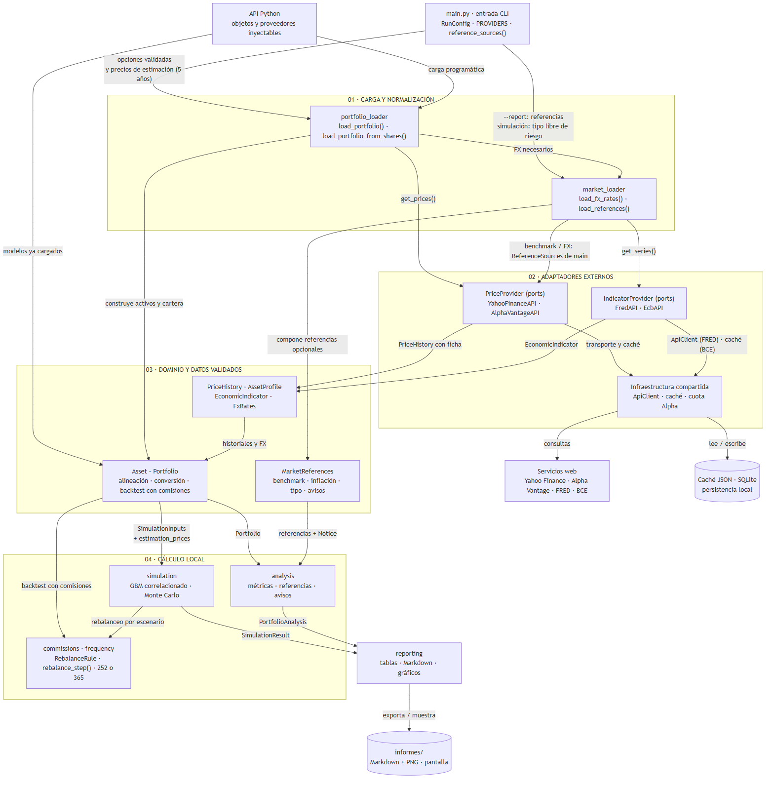
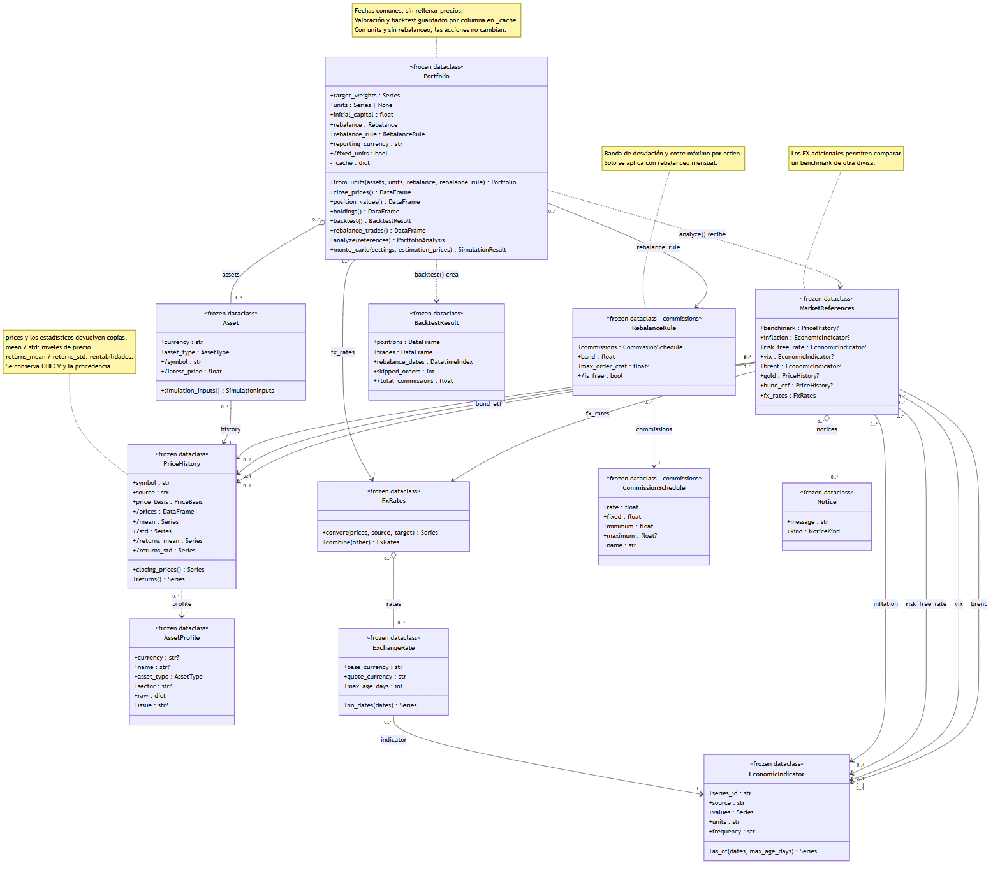
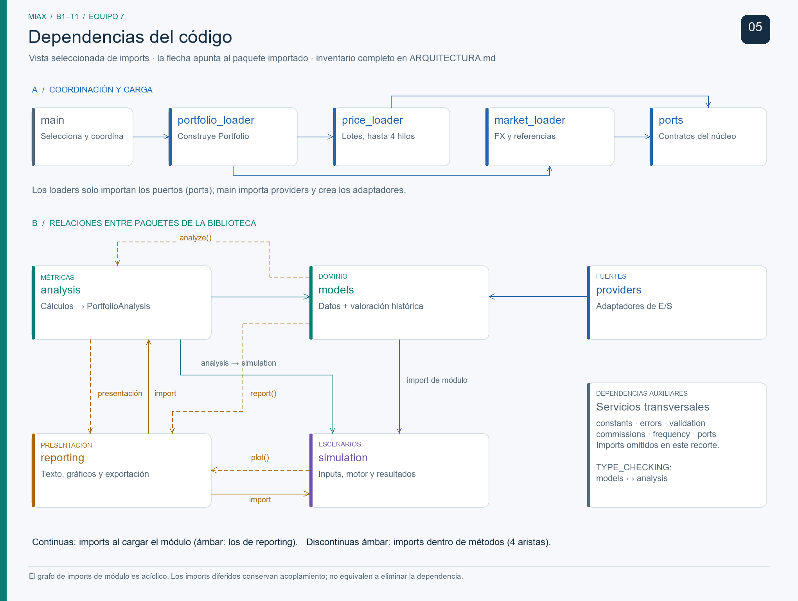
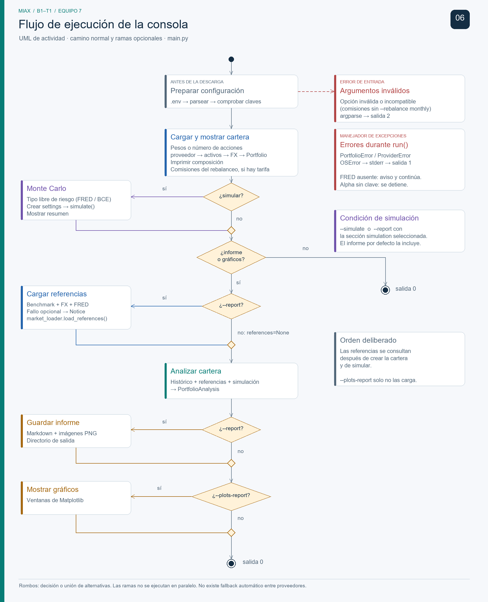

# Arquitectura · B1–T1 / Equipo 7

Cuatro vistas explican la estructura del toolkit, sus contratos y su ejecución. Además de la vista general (01), cubren lo que pide el enunciado en su apartado 4.6: la jerarquía de clases (02), las dependencias (05) y el flujo del sistema (06). Los nombres de clases y métodos coinciden con el código. Cada lámina es un archivo Mermaid (`.mmd`) con su exportación en PNG, ambos en [`diagramas/`](diagramas/README.md).

**Referencia:** código del commit **`fb2d2ea`** (8 de noviembre de 2026): comisiones del rebalanceo, ventana de estimación de Monte Carlo y `returns_mean` / `returns_std` en `PriceHistory`; las láminas 01 y 05 incluyen además los puertos de `src/ports.py` ([decisión 74](Decisiones.MD)). Al cambiar el código, hay que revisar qué láminas quedan afectadas.

| Lámina | Vista formal | Pregunta que responde |
| --- | --- | --- |
| [01 · Arquitectura](#01--arquitectura-del-sistema) | Componentes y responsabilidades | ¿Qué hace cada parte y dónde ocurre la E/S? |
| [02 · Modelos de dominio](#02--modelos-de-dominio) | Clases UML | ¿Qué objetos forman una cartera y qué referencias comparten? |
| [05 · Dependencias](#05--dependencias-entre-paquetes) | Dependencias de paquetes | ¿Qué módulos dependen de cuáles y cuándo se importan? |
| [06 · Flujo CLI](#06--flujo-de-la-aplicación) | Actividad UML | ¿Qué pasos y decisiones sigue una ejecución? |

## Cómo leer las láminas

| Notación | Significado |
| --- | --- |
| Rombo hueco | Agregación compartida: la parte puede existir y reutilizarse fuera del conjunto. |
| Asociación con multiplicidad | Referencia conservada por un objeto; `1`, `0..1`, `1..*` y `0..*` indican cardinalidades. |
| Dependencia discontinua | Uso de un tipo, función o paquete; no implica guardar una referencia. |
| `frozen=True` | Impide reasignar atributos; no garantiza inmutabilidad profunda ni validación automática del contenido. |

Las flechas se interpretan según la vista: **responsabilidad/interacción** en 01, **importación** en 05 y **orden de ejecución** en 06. Las multiplicidades describen referencias, no cantidades de peticiones ni escenarios.

## 01 · Arquitectura del sistema

[Fuente Mermaid](diagramas/01-arquitectura.mmd)

Esta vista organiza **responsabilidades y llamadas del sistema**, no todas las importaciones. `main` compone la ejecución; los cargadores obtienen y transforman datos, incluidos los precios de 5 años con los que Monte Carlo estima la volatilidad y las correlaciones; los adaptadores encapsulan los servicios externos (Yahoo, Alpha Vantage, FRED y BCE). Los módulos transversales `commissions` y `frequency` aplican la misma regla de rebalanceo y el mismo calendario (252 o 365) en el histórico y en la simulación. Los modelos y los cálculos trabajan con contratos normalizados. `reporting` presenta resultados y escribe Markdown e imágenes, por lo que sí realiza E/S local.

La entrada de datos sigue **puertos y adaptadores**: `src/ports.py` define en el núcleo los contratos `PriceProvider`, `IndicatorProvider` (FRED y BCE) y `ReferenceSources`, y `errors` el `ProviderError` común. Los cargadores solo reciben esos puertos; `main` es el único módulo que elige y crea adaptadores (registro `PROVIDERS` y `reference_sources()`). El resto no es una hexagonal estricta: `Portfolio.report()`, `.plots_report()` y `SimulationResult.plot()` son fachadas que el enunciado pide en el dominio y que llegan a `reporting` ([decisión 74](Decisiones.MD)).

Yahoo y Alpha Vantage cumplen `PriceProvider.get_prices()` por estructura, sin heredar del protocolo; FRED y el BCE cumplen `IndicatorProvider.get_series()` y devuelven `EconomicIndicator`. Cada adaptador traduce su formato externo al dominio común (patrón **Adapter**). Alpha y FRED usan `ApiClient`, y Alpha añade el control de cuota persistente `AlphaVantageQuota`. Con el atributo opcional `max_download_workers`, Yahoo admite 4 descargas simultáneas y Alpha 1.

**Fuentes:** [main.py](src/main.py), [ports.py](src/ports.py), [providers/base.py](src/providers/base.py), [portfolio_loader.py](src/portfolio_loader.py), [price_loader.py](src/price_loader.py), [market_loader.py](src/market_loader.py), [providers](src/providers), [reporting/export.py](src/reporting/export.py).

## 02 · Modelos de dominio

[Fuente Mermaid](diagramas/02-modelos-dominio.mmd)

`PriceHistory` conserva precios y procedencia; `AssetProfile`, los metadatos; `Asset`, la identidad y divisa del activo. `Portfolio` reúne activos y asigna pesos, capital y política de rebalanceo; `Portfolio.from_units()` la crea a partir del número de acciones, que conserva en `units`; sin rebalanceo las cantidades no cambian y con `rebalance="monthly"` cada mes se vuelve a los pesos iniciales. `rebalance_rule` (`RebalanceRule`, del módulo `commissions`) fija la tarifa del bróker (`CommissionSchedule`), la banda de desviación y el coste máximo por orden; `Portfolio.backtest()` devuelve un `BacktestResult` con la valoración, las órdenes y las comisiones pagadas. Un activo puede participar en varias carteras: su peso pertenece a cada cartera, no al propio activo. Por eso las relaciones del dominio usan asociación o agregación compartida.

`FxRates` agrupa pares directos o inversos y `ExchangeRate` añade significado de divisa a un `EconomicIndicator`. `MarketReferences` contiene referencias opcionales de benchmark, inflación, tipo libre de riesgo, VIX, Brent, oro y ETF de Bunds, además de cambios de divisa para el benchmark. `FxRates.combine()` permite reunirlos con los de la cartera para la comparación.

`PriceHistory` guarda copias defensivas y calcula al construirse la media y la desviación típica de los niveles de precio (`mean`, `std`) y de las rentabilidades de `Close` y `Adj Close` (`returns_mean`, `returns_std`); los pesos y los indicadores protegen su almacenamiento numérico. Esto no convierte todos los contenedores y resultados del sistema en profundamente inmutables. La alineación de activos conserva fechas comunes sin rellenar huecos; no implementa un calendario bursátil explícito.

`Asset` y `Portfolio` construyen `SimulationInputs` y delegan en la misma función `simulate()`: no hay superclase común de simulación, sino **composición y un contrato de datos**. `SimulationSettings` reúne la configuración (escenarios, pasos, semilla, supuestos) y `SimulationResult` guarda las trayectorias, la `RebalanceRule` aplicada y las comisiones de cada escenario. El backtest histórico y Monte Carlo aplican la misma regla con `rebalance_step()`, del módulo `commissions`.

**Fuentes:** [models/portfolio.py](src/models/portfolio.py), [asset.py](src/models/asset.py), [price_history.py](src/models/price_history.py), [currency.py](src/models/currency.py), [references.py](src/models/references.py), [snapshot.py](src/models/snapshot.py), [backtest.py](src/models/backtest.py), [commissions.py](src/commissions.py), [simulation/monte_carlo.py](src/simulation/monte_carlo.py).

## 05 · Dependencias entre paquetes

[Fuente Mermaid](diagramas/05-dependencias.mmd)

Una flecha va del **importador al importado**. La lámina selecciona las importaciones principales entre paquetes y cuatro aristas internas diferidas; omite las relaciones dentro de cada paquete, las bibliotecas externas y las dependencias transversales recogidas abajo. `reporting` importa al cargarse funciones de `analysis` (`annualized_growth`, `evaluate_simulation`) y de `simulation` (`MODEL_RETURN`, `SimulationSettings`); ninguna de ellas crea un ciclo, porque las importaciones inversas son diferidas. No es el grafo completo de carga de Python ni una afirmación de ausencia total de ciclos.

| Arista diferida | Lugar y propósito |
| --- | --- |
| `models → analysis` | `Portfolio.analyze()` importa `analyze_portfolio`. |
| `models → reporting` | `Portfolio.report()` importa `select_sections`. |
| `analysis → reporting` | Métodos de `PortfolioAnalysis` importan construcción, exportación y gráficos. |
| `simulation → reporting` | `SimulationResult.plot()` importa funciones de gráficos. |

Se difiere la **sentencia concreta**, no necesariamente la primera carga efectiva del paquete: otras rutas de ejecución pueden haberlo importado ya. La CLI también tiene una importación local externa de `matplotlib.pyplot`.

| Dependencia transversal | Consumidores directos de nivel superior dentro de `src/` |
| --- | --- |
| `constants` | `main`, `portfolio_loader`, `market_loader`, `models`, `providers`, `simulation`, `analysis`, `reporting`, `validation`, `frequency`. |
| `errors` | `main`, `portfolio_loader`, `price_loader`, `market_loader`, `models`, `providers`, `simulation`, `analysis`, `reporting`, `validation`, `commissions`. |
| `validation` | `main`, `portfolio_loader`, `price_loader`, `models`, `providers`, `simulation`, `analysis`, `reporting`, `commissions`. |
| `commissions` | `main`, `portfolio_loader`, `models`, `simulation`, `analysis`, `reporting`. |
| `frequency` | `simulation`, `analysis`. |
| `ports` | `main`, `portfolio_loader`, `price_loader`, `market_loader`, `providers`. |

| Importaciones bajo `TYPE_CHECKING` entre paquetes | Tipos utilizados |
| --- | --- |
| `models → analysis` | `PortfolioAnalysis`, `WarningThresholds`. |
| `analysis → models` | `Portfolio`; el paquete ya tiene otras importaciones de modelos en ejecución. |
| `reporting → analysis` | `PortfolioAnalysis` en `export`, `plots` y `report`. |
| `reporting → simulation` | `SimulationResult` en `export`, `plots` y `report`. |

Estas últimas sirven a anotaciones y comprobadores de tipos; sus bloques no se ejecutan normalmente. Además, `reporting` importa al cargar `analysis` (métricas y avisos) y `simulation` (supuestos de Monte Carlo); la lámina 05 los incluye entre los imports de módulo. Solo `main` importa `providers`: los cargadores importan `ports`. El grafo de imports de módulo sigue siendo acíclico. La tabla agrupa módulos por paquete y no incluye importaciones internas del mismo paquete ni reexportaciones de `__init__.py`.

**Fuentes:** [portfolio.py](src/models/portfolio.py), [analysis/result.py](src/analysis/result.py), [analysis/portfolio_analysis.py](src/analysis/portfolio_analysis.py), [simulation/result.py](src/simulation/result.py), [reporting](src/reporting), [main.py](src/main.py).

## 06 · Flujo de la aplicación

[Fuente Mermaid](diagramas/06-flujo-cli.mmd)

La CLI carga entorno y argumentos, comprueba la configuración necesaria y crea los colaboradores. El cargador obtiene los históricos y, cuando procede, los tipos de cambio antes de construir la cartera. Parte de la validación necesita los datos y ocurre al construir modelos o ejecutar cálculos: el análisis de argumentos no sustituye esas comprobaciones.

Las opciones de comisiones (`--commission-*`, `--rebalance-band`, `--max-order-cost`) solo se admiten con `--rebalance monthly`; en otro caso `argparse` termina con código `2`. Después se muestran las posiciones, con las comisiones del backtest si hay tarifa. Si se pide informe o gráficos, la cartera se analiza antes de simular, para avisar de datos insuficientes sin simular en balde: con `--report` se descargan todas las referencias económicas y con `--plots-report` solo el índice de `--benchmark`, si se indica. Luego se ejecuta la simulación si la configuración la solicita; antes de simular se consulta el tipo libre de riesgo de la divisa. Con Yahoo, la simulación descarga además los precios de los 5 años anteriores (o desde `--start`, si es anterior; o desde `--estimation-start`) para estimar la volatilidad y las correlaciones, y avisa si cubren menos de 3 años. El informe recibe el resultado de la simulación al guardarse. La selección de secciones del informe también puede activar su simulación al preparar la configuración.

`price_loader.load_price_histories()` descarga los historiales de cada lote (cartera por pesos, por acciones y precios de estimación) con hasta `--download-workers` descargas simultáneas, limitadas por el proveedor y por el número de activos; con una sola, no crea hilos. Devuelve los historiales en el orden de entrada y los activos y la cartera se crean después, en el hilo principal. Ante el primer fallo deja de enviar descargas, cancela las pendientes y propaga el error con el símbolo. Los tipos de cambio, el índice de referencia, FRED y el BCE siguen en secuencia. La lámina 05 sitúa `price_loader` entre los cargadores y la 06 indica el límite de `--download-workers` en la carga de la cartera.

Las referencias opcionales fallidas se explican mediante avisos y medidas ausentes cuando la carga admite degradación; otros errores terminan la ejecución. `main()` devuelve `0` al completar y `1` para `PortfolioError`, `ProviderError` u `OSError`; los errores de argumentos siguen el comportamiento de `argparse`.

**Fuentes:** [main.py](src/main.py), [portfolio_loader.py](src/portfolio_loader.py), [price_loader.py](src/price_loader.py), [market_loader.py](src/market_loader.py), [reporting/export.py](src/reporting/export.py).

## Edición, reproducción y alcance

[La guía de diagramas](diagramas/README.md) explica cómo ver y editar las láminas y cómo volver a exportar los PNG. El `.mmd` es la fuente: se mantiene a mano y debe revisarse junto al código. El PNG es su exportación, para insertarla en diapositivas o documentos.

Los diagramas documentan contratos y decisiones observados. Su revisión visual no equivale a ejecutar consultas reales de proveedores ni a certificar todos los comportamientos de la práctica.
