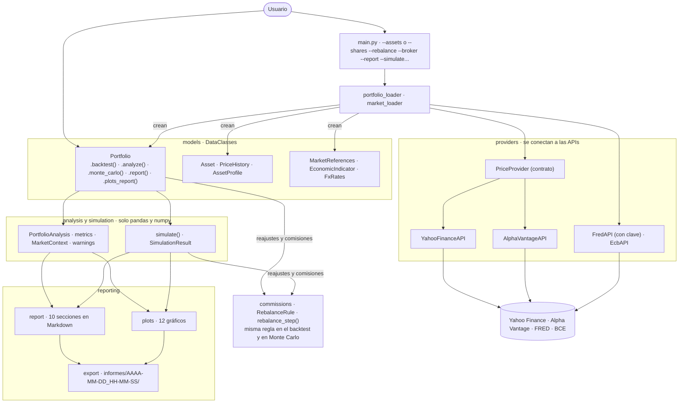
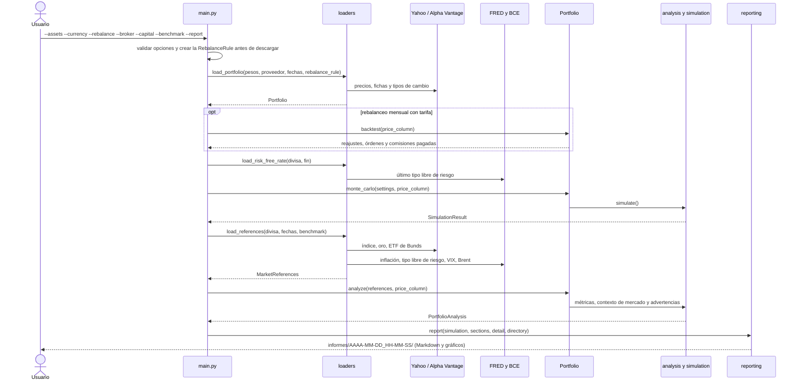

# Arquitectura

GitHub dibuja estos diagramas directamente (Mermaid). Para editarlos o exportarlos a imagen: <https://mermaid.live>.

## 1. Capas y dependencias

El usuario trabaja con la consola (`src/main.py`) o con `Portfolio`. La capa de **proveedores** es la única que se conecta a internet, y la carga de datos la usa a través del contrato `PriceProvider`, nunca de una API concreta: cambiar de Yahoo a Alpha Vantage (o añadir otra API) no toca el resto del sistema.

## 2. Diagrama de clases (UML)

```mermaid
classDiagram
    direction TB

    class PriceProvider {
        <<protocol>>
        +get_prices(symbol, start, end, adjusted) PriceHistory
    }
    class YahooFinanceAPI
    class AlphaVantageAPI {
        +api_key: str
    }
    class FredAPI {
        +get_series(series_id, start, end) EconomicIndicator
    }
    class EcbAPI {
        +get_series(series_id, start, end) EconomicIndicator
    }
    PriceProvider <|.. YahooFinanceAPI
    PriceProvider <|.. AlphaVantageAPI

    class AssetProfile {
        <<dataclass>>
        +currency: str
        +name: str
        +asset_type: str
        +sector: str
        +country: str
    }
    class PriceHistory {
        <<dataclass>>
        +symbol: str
        +source: str
        +prices: DataFrame
        +profile: AssetProfile
        +price_basis: str
        +mean: Series
        +std: Series
        +closing_prices(column) Series
        +returns(log, column) Series
    }
    class Asset {
        <<dataclass>>
        +history: PriceHistory
        +currency: str
        +asset_type: str
        +equity_share: float
        +monte_carlo(settings) SimulationResult
    }
    class EconomicIndicator {
        <<dataclass>>
        +series_id: str
        +source: str
        +values: Series
        +units: str
        +frequency: str
        +as_of(dates, max_age_days) Series
    }
    class FxRates {
        <<dataclass>>
        +rates: tuple
        +convert(prices, source, target) Series
    }
    class MarketReferences {
        <<dataclass>>
        +benchmark: PriceHistory
        +inflation: EconomicIndicator
        +risk_free_rate: EconomicIndicator
        +vix: EconomicIndicator
        +brent: EconomicIndicator
        +gold: PriceHistory
        +bund_etf: PriceHistory
        +benchmark_fx: FxRates
        +notices: tuple
    }
    class Portfolio {
        <<dataclass>>
        +assets: Sequence
        +target_weights: Series
        +reporting_currency: str
        +fx_rates: FxRates
        +initial_capital: float
        +rebalance: str
        +units: Series
        +rebalance_rule: RebalanceRule
        +from_units(assets, units, rebalance, rebalance_rule)$ Portfolio
        +holdings(price_column) DataFrame
        +backtest(price_column) BacktestResult
        +analyze(references) PortfolioAnalysis
        +monte_carlo(settings) SimulationResult
        +report(references, simulation, sections, detail) Path
        +plots_report(directory, show) dict
    }
    class CommissionSchedule {
        <<dataclass>>
        +name: str
        +rate: float
        +fixed: float
        +minimum: float
        +maximum: float
    }
    class RebalanceRule {
        <<dataclass>>
        +commissions: CommissionSchedule
        +band: float
        +max_order_cost: float
        +is_free: bool
    }
    class BacktestResult {
        <<dataclass>>
        +positions: DataFrame
        +trades: DataFrame
        +rebalance_dates: DatetimeIndex
        +skipped_orders: int
        +total_commissions: float
    }
    class RebalanceCosts {
        <<dataclass>>
        +rule: RebalanceRule
        +rebalances: int
        +commissions: float
        +final_value: float
        +buy_and_hold_value: float
        +advantage: float
    }
    class SimulationSettings {
        <<dataclass>>
        +steps: int
        +simulations: int
        +seed: int
        +confidence: float
        +expected_returns: float
        +volatilities: float
        +equity_premium: float
        +risk_free_rate: float
    }
    class SimulationResult {
        <<dataclass>>
        +paths: DataFrame
        +assumptions: DataFrame
        +confidence: float
        +rebalance_rule: RebalanceRule
        +commissions: Series
        +mean_commissions: float
        +summary() Series
        +plot(show, max_paths) Figure
    }
    class MarketContext {
        <<dataclass>>
        +vix_current: float
        +brent_correlation: float
        +gold_correlation: float
        +bund_etf_correlation: float
        +bund_on_worst_days: float
        +fx_effect: Series
    }
    class RiskWarning {
        <<dataclass>>
        +code: str
        +severity: str
        +message: str
        +observed: float
        +threshold: float
    }
    class PortfolioAnalysis {
        <<dataclass>>
        +values: Series
        +metrics: Series
        +holdings: DataFrame
        +correlations: DataFrame
        +market: MarketContext
        +risk_warnings: list
        +notices: list
        +rebalance_costs: RebalanceCosts
        +markdown(sections, detail) str
        +report(simulation, sections, detail, directory) Path
        +plots_report(directory, show) dict
    }

    PriceProvider ..> PriceHistory : crea
    FredAPI ..> EconomicIndicator : crea
    EcbAPI ..> EconomicIndicator : crea
    PriceHistory *-- AssetProfile
    Asset *-- PriceHistory
    Portfolio "1" o-- "1..*" Asset : assets
    Portfolio o-- FxRates
    MarketReferences o-- PriceHistory
    MarketReferences o-- EconomicIndicator
    MarketReferences o-- FxRates
    Portfolio ..> SimulationSettings : usa
    Portfolio ..> SimulationResult : crea
    Portfolio ..> MarketReferences : usa
    Portfolio ..> PortfolioAnalysis : crea
    PortfolioAnalysis *-- MarketContext
    PortfolioAnalysis o-- RiskWarning
    Portfolio o-- RebalanceRule
    RebalanceRule o-- CommissionSchedule
    Portfolio ..> BacktestResult : crea
    PortfolioAnalysis *-- RebalanceCosts : solo con rebalanceo mensual
    RebalanceCosts o-- RebalanceRule
    SimulationResult o-- RebalanceRule
```

## 3. Flujo de una ejecución

