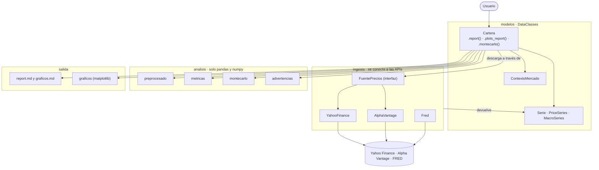
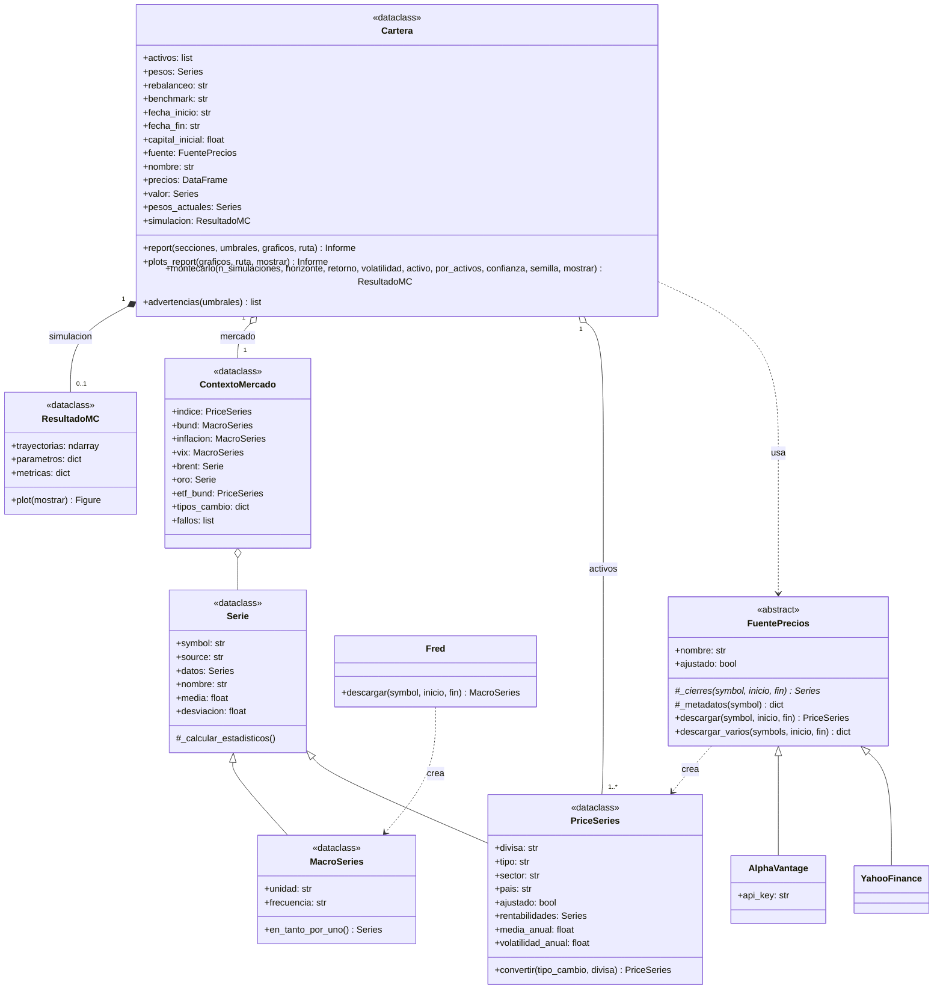
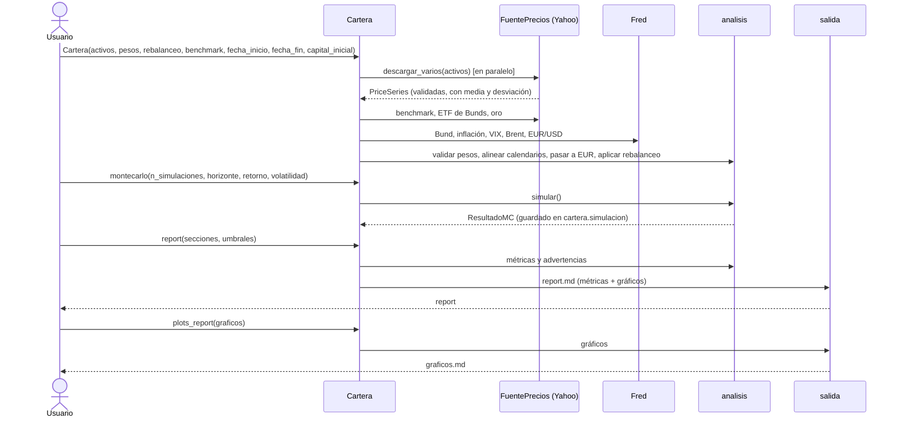

# Arquitectura del toolkit

GitHub dibuja estos diagramas directamente (Mermaid). Para editarlos o exportarlos a imagen: <https://mermaid.live>.

## 1. Capas y dependencias

El usuario solo trabaja con `Cartera`. La capa de **ingesta** es la única que se conecta a internet, y la cartera la usa a través de la interfaz `FuentePrecios`, nunca de una API concreta: cambiar de Yahoo a Alpha Vantage (o añadir otra API) no toca el resto del sistema.

## 2. Diagrama de clases (UML)

## 3. Flujo de una ejecución

